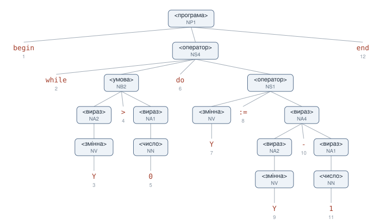
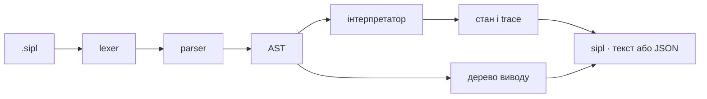

<div align="center">



# sipl

**Мова SIPL з «Теорії програмування»: розібрати, виконати, простежити, намалювати.**
<br>Написано на Rust, один бінарник без залежностей.

[](https://github.com/ovolovikk/sipl-rust/actions/workflows/ci.yml)
[](https://github.com/ovolovikk/sipl-rust/releases/latest)
[](LICENSE)

</div>

## Спробувати

Готовий бінарник для Linux, macOS і Windows лежить на сторінці [релізу](https://github.com/ovolovikk/sipl-rust/releases/latest).
Або можна зібрати з коду:

```bash
cargo install --git https://github.com/ovolovikk/sipl-rust
sipl run examples/power.sipl X=2 Y=10
```

| Команда | Що робить |
|---|---|
| `sipl run файл X=2` | виконує програму, друкує кінцевий стан |
| `sipl trace файл X=2` | показує кожен крок: присвоювання, перевірки умов |
| `sipl tree файл` | будує дерево синтаксичного виводу; `--svg` дає картинку |
| `sipl parse файл` | друкує AST |
| `sipl check файл` | лише перевіряє синтаксис |

З `--json` будь-яка команда відповідає одним рядком JSON. Деталі: [`docs/cli.md`](docs/cli.md).

## Дерево виводу

`sipl tree examples/countdown.sipl --svg`:

<p align="center"></p>

Листки, прочитані зліва направо, дають текст програми: це і є перевірка синтаксичної
правильності. Тести перевіряють її для кожного вузла кожної коректної програми.
Більше дерево: [`power.sipl`](docs/power-tree.svg).

## Як це влаштовано



| Що | Де | Опис |
|---|---|---|
| граматика | [`grammar/sipl.ebnf`](grammar/sipl.ebnf) | БНФ, переписана в EBNF з пріоритетами, [`docs/grammar.md`](docs/grammar.md) |
| інтерпретатор | [`src/interpreter.rs`](src/interpreter.rs) | кожна конструкція виконується своєю композицією: `AS`, `IF`, `WH`…, [`docs/interpreter.md`](docs/interpreter.md) |
| trace | [`src/trace.rs`](src/trace.rs) | події до й після операторів, зміни змінних, [`docs/trace.md`](docs/trace.md) |
| дерево виводу | [`src/parse_tree.rs`](src/parse_tree.rs) | текст, JSON, DOT, SVG, [`docs/tree.md`](docs/tree.md) |
| редактор | [`vscode-sipl/`](vscode-sipl/README.md) | підсвітка й сніпети для VS Code, `.vsix` є в релізі |

## Тести специфікації

66 [тестів специфікації](spec-tests/README.md) запускають `sipl` як чорну скриньку й перевіряють
лише JSON-вивід, тому підходять для будь-якої реалізації SIPL з таким самим командним рядком:

```bash
pwsh scripts/spec-tests.ps1 -Sipl шлях/до/sipl
```

## Завдання курсового проєкту

<details>
<summary>Обрано завдань на <b>10.5 бала</b>: CORE-01…06, VIS-01, IDE-01, REL-01, REL-02</summary>
<br>

| ID | Що | Бали |
|---|---|---|
| CORE-01 | граматика й приклади | 0.5 |
| CORE-02 | парсер і AST з позиціями | 1.5 |
| CORE-03 | інтерпретатор з лімітом ітерацій | 2.0 |
| CORE-04 | події виконання та trace | 1.0 |
| CORE-05 | командний рядок і JSON | 1.0 |
| CORE-06 | тести специфікації | 1.0 |
| VIS-01 | дерево синтаксичного виводу | 1.5 |
| IDE-01 | розширення VS Code | 1.0 |
| REL-01 | CI | 0.5 |
| REL-02 | релізи, [`CHANGELOG.md`](CHANGELOG.md) | 0.5 |

</details>

## Розробка

```bash
cargo test            # усі тести
pwsh scripts/ci.ps1   # як у CI: формат, clippy, тести, специфікація, покриття ≥ 80%, пакет, розширення
```

Еталони тестів оновлюються командою `SIPL_BLESS=1 cargo test --test fixtures`.
